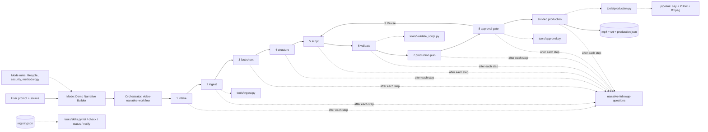

# Demo Video Generator and Demo Narrative Builder

This repository holds two parts that work together:

1. **Demobuilder video pipeline** - renders demo videos (voice-over, captions, 1920x1080 MP4) from markdown script
   tables (`| TIMING | VISUAL | VO |`). It produced the HexStrike deep-dive and the IBM Bob client demo.
2. **Demo Narrative Builder** - a redistributable Bob asset package (`dist/`, shipped as a zip): one custom mode, a
   **skill system of nine independent step skills** (plus an orchestrator and a follow-up-questions skill), mode
   rules, templates, a skill registry and tested Python tools. It turns a **hosted blog (URL), PDF, TXT/Markdown or
   Word (.docx) document** into a timed, scene-by-scene **video narrative script** with a production plan,
   follow-up questions at every step, a hard approval gate and, as step 9, the **produced video** (voice-over, MP4
   and captions) by running part 1.

The narrative method is the one used for the two demo scripts: intake, source facts, section map,
`| TIMING | VISUAL | VO |` table, production plan, explicit approval, video production, outcome record.

Repository: <https://github.com/ncee-dp-tech-sme/demo-video-generator>
Package version 2.2.3 (pipeline files bundled in the zip; see the change notes in section 13).

## Contents

1. [Overview](#1-overview)
2. [Quick start](#2-quick-start)
3. [Prerequisites](#3-prerequisites)
4. [Installation and setup](#4-installation-and-setup)
5. [Usage guidelines](#5-usage-guidelines)
6. [Architecture and file structure](#6-architecture-and-file-structure)
7. [Security model](#7-security-model)
8. [Testing](#8-testing)
9. [Step 9: video production](#9-step-9-video-production)
10. [Building the demo videos directly](#10-building-the-demo-videos-directly)
11. [Troubleshooting](#11-troubleshooting)
12. [Limitations](#12-limitations)
13. [Change notes](#13-change-notes)

---

## 1. Overview

### 1.1 Repository contents

| Path | Purpose |
|---|---|
| `dist/pipeline/demo_common.py`, `build_audio.py`, `build_video.py` | Shared parser/timeline and the HexStrike audio and video stages |
| `dist/pipeline/build_bob_audio.py`, `build_bob_video.py`, `bob_ui.py`, `bob_scenes_a.py`, `bob_scenes_b.py` | IBM Bob client demo stages and scenes |
| `dist/pipeline/generic_audio.py`, `generic_video.py` | Default renderer for step 9 |
| `HexStrike_AV_script_v1.md`, `IBM_Bob_Client_Demo_script_v1.md`, `IBM_Bob_Client_Demo_script_v2.md` | Script tables |
| `requirements.txt`, `.env.example` | Pipeline dependencies and settings (`VOICE`, `SPEECH_RATE`, `FPS`, `LOG_LEVEL`, `SCRIPT_FILE`, `BUILD_DIR`) |
| `dist/` | Sources of the Demo Narrative Builder package, including the whole video pipeline in `dist/pipeline/` (layout in 6.1) |
| `releases/` | The ready-to-install zip `demo-narrative-builder-2.2.3.zip` and its `SHA256SUMS` |
| `docs/README.md` | Copy of this document (kept identical to the root `README.md`) |
| `hexstrikesdlc/`, `task-outcomes/` | Source facts and task records |

Not in git (see `.gitignore`): `.env`, `.venv/`, `build/`, `output/` (rendered videos), `.bob/`, caches.

### 1.2 The demo videos and the pipeline

The repository contains the **scripts and the code that renders the videos, not the rendered videos**. The
generated files (`output/*.mp4`, `output/*.srt`, plus intermediate audio and frames in `build/`) are git-ignored
and are created on your machine when you run the pipeline (section 10; macOS is needed for the `say` voice-over).

| Video | Script (in the repository) | Rendered locally to (not in the repository) |
|---|---|---|
| HexStrike deep-dive (~3:01) | `HexStrike_AV_script_v1.md` | `output/HexStrike_demo.mp4` + `.srt` |
| IBM Bob client demo (~7:01) | `IBM_Bob_Client_Demo_script_v2.md` | `output/IBM_Bob_Client_Demo.mp4` + `.srt` |

Each rendered video is 1920x1080 at 24 fps with macOS `say` voice-over and burned-in captions. The pipeline has two stages:

1. Audio stage - synthesises the VO per scene with macOS `say`, fits it to each scene window (raises the rate up
   to 235 wpm, then borrows time from the next scene), writes `timeline.json` and mixes VO + ambient bed + sfx
   into `audio.wav`.
2. Video stage - renders every frame with Pillow (multi-process), burns in captions, pipes frames to the ffmpeg
   binary bundled in `imageio-ffmpeg`. Visual cues are synchronised to spoken words (`demo_common.cue()`).

Step 9 of the Demo Narrative Builder runs this pipeline. How to run it directly: section 10.

### 1.3 Demo Narrative Builder components

| Component | Name | Purpose |
|---|---|---|
| Custom mode | `demo-narrative-builder` ("Demo Narrative Builder") | Persona and tool permissions: read, edit (`.md .txt .json .srt` only), execute, skill, todo |
| Skills (9) | `narrative-01-intake` ... `narrative-09-video-production` | One independent skill per workflow step; step 9 is video production (see 1.4) |
| Skill | `video-narrative-workflow` | Orchestrator: runs steps 1 to 9 in order or any single step, tracks progress |
| Skill | `narrative-followup-questions` | Generates 3 to 5 follow-up questions with defaults after every step (1 to 9) |
| Registry | `registry.json` | Machine-readable catalog of the skills: step, id, tool, required and produced files |
| Rules | `rules-demo-narrative-builder/` | Lifecycle, source security, methodology; loaded only in this mode |
| Tool | `tools/ingest.py` | Safe extraction and normalisation of the four input formats |
| Tool | `tools/validate_script.py` | Checks structure, timing, voice-over fit, follow-ups, approval gate; writes `validation.json` |
| Tool | `tools/skills.py` | Skill menu (`list`, `show`), inputs check (`check`), progress (`status`), consistency check (`verify`) |
| Tool | `tools/approval.py` | Records the approval bound to the script's sha256 (step 8) and verifies it (step 9) |
| Tool | `tools/production.py` | Step 9 gate and prerequisite check, staged audio, review frames and render |
| Pipeline | `pipeline/` | Complete video pipeline, shipped in the zip and used by default for step 9: `demo_common.py`, `build_audio.py`, `build_video.py`, the IBM Bob renderers and the default `generic_audio.py`, `generic_video.py` (storyboard cards, captions, voice-over) |
| Templates | `templates/` | Script, production plan, fact sheet, follow-ups and outcome record |
| Installer | `install.py` / `install.sh` | Install, backup, rollback (`--uninstall`) |

### Supported input formats

| Format | Input | Notes |
|---|---|---|
| Hosted blog | `https://...` URL | HTML or plain text pages; public hosts only; no login, no JavaScript rendering |
| PDF | `.pdf` | Text layer only (no OCR); encrypted PDFs rejected; one section per page |
| Text | `.txt`, `.md` | `#` headings become sections |
| Word | `.docx` | Title and Heading styles become sections; tables are read in document order |

### 1.4 The nine skills

Every step is a separate skill with its own inputs, output file and follow-up questions. Any skill can be started
on its own when its inputs exist (`tools/skills.py check <slug> <step>`); a full run just chains them. Step 9,
video production, is a full member of the set, not an add-on.

| # | Skill | Needs | Produces (in `narratives/<slug>/`) | Tool | Follow-up questions (examples) |
|---|---|---|---|---|---|
| 1 | `narrative-01-intake` | nothing | `intake.json` | - | Who is the viewer? Which sections are mandatory? |
| 2 | `narrative-02-ingest` | a source (URL or file) | `source.json`, `source.txt` | `ingest.py` | Is this the final version? Anything to exclude? |
| 3 | `narrative-03-fact-sheet` | `source.json` | `factsheet.md` (F1..Fn, gaps) | - | Which top facts matter most? How to handle gap G1? |
| 4 | `narrative-04-structure` | `factsheet.md`, `intake.json` | `structure.md` (section map) | - | Does the map cover every mandatory section? |
| 5 | `narrative-05-script` | `factsheet.md`, `structure.md`, `intake.json` | `<slug>_script_vN.md` | - | Tone? Which claims need legal review? |
| 6 | `narrative-06-validate` | a script | `validation.json` | `validate_script.py` | Scene 3 is tight; shorten or extend? |
| 7 | `narrative-07-production-plan` | a validated script | plan section inside the script | `validate_script.py --require-plan` | Which visual approach and voice? |
| 8 | `narrative-08-approval-gate` | a script with plan | `approval.json` (sha256-bound) | `approval.py` | Open placeholders? |
| 9 | `narrative-09-video-production` | `approval.json` for the exact script | `production.json`, `production/output/<name>.mp4` + `.srt`, `production/review/*.png` | `production.py` | Scenes extended? Which scenes need a different look? |

Support: `video-narrative-workflow` (orchestrator) and `narrative-followup-questions` (used after every step).
Task completion (after step 9, or when a task stops earlier): `task-outcomes/<slug>.txt`.

At the end of every step the mode shows 3 to 5 numbered potential follow-up questions with suggested
defaults and appends them to `narratives/<slug>/followups.md`. The script itself also carries a
"Follow-up questions by section" table (what a viewer or reviewer will ask, per section).

Skill menu and progress in the terminal:

```bash
$PY tools/skills.py list                 # the nine skills plus orchestrator and support skill
$PY tools/skills.py status my-post       # which steps are done, which is next
$PY tools/skills.py check my-post 9      # can step 9 start? lists missing inputs
```

---

## 2. Quick start

Install the Demo Narrative Builder from the release zip (details and alternatives in section 4):

```bash
# 1. download the zip and its checksum (needs `gh auth login`; or use the browser, see 4.1)
for f in demo-narrative-builder-2.2.3.zip SHA256SUMS; do
  gh api -H "Accept: application/vnd.github.raw" \
    "repos/ncee-dp-tech-sme/demo-video-generator/contents/releases/$f" > "$f"
done
shasum -a 256 -c SHA256SUMS                      # must print: demo-narrative-builder-2.2.3.zip: OK

# 2. unpack, preview, install
unzip demo-narrative-builder-2.2.3.zip && cd demo-narrative-builder
./install.sh --dry-run
./install.sh --scope workspace --target /path/to/your/workspace      # asks for confirmation
```

Then open the workspace in Bob, start a **new task**, choose the mode **Demo Narrative Builder** and type:

```text
Create a 3-minute client video narrative from https://example.com/blog/my-post
```

or `from /path/to/whitepaper.pdf`, `from notes.txt`, `from proposal.docx`.

Step 9 (video production) works out of the box: the pipeline files are in the installed `pipeline/` folder, the default when `.env` does not set `DEMOBUILDER_DIR` (see 4.3).
To run one skill only, say so: `Run step 6 for my-post`, `Make the video for my-post` (step 9), `Show the skills`.

Roll back at any time: `./install.sh --uninstall --scope workspace --target /path/to/your/workspace`.

---

## 3. Prerequisites

### 3.1 Software

| Requirement | Version | Why | Check |
|---|---|---|---|
| Operating system | macOS or Linux (developed and tested on macOS, Apple silicon); **step 9 needs macOS** | Shell launcher is Bash/ZSH; steps 1 to 8 also run on Linux; untested on Windows | `uname` |
| Python | 3.10 or newer (tested with 3.14.7) | Tools and installer | `python3 --version` |
| `venv` module and `pip` | bundled with Python | Private virtual environment, pinned dependencies | `python3 -m venv --help` |
| Bob IDE | A version with custom modes, skills and mode rule folders | Loads the mode, skills and rules | Settings, Modes tab |
| Git | any recent version | Optional, for versioning your `narratives/` folder | `git --version` |

No other system packages are needed for steps 1 to 8. `pdftotext`, `pandoc`, `ffmpeg` and OCR tools are **not** required (step 9 uses the ffmpeg bundled in `imageio-ffmpeg`).

### 3.2 Python libraries (pinned in `requirements.txt`)

| Package | Version | Used for | Licence | Vulnerability check (OSV.dev, 14 Nov 2026) |
|---|---|---|---|---|
| `pypdf` | 7.1.0 | PDF text extraction | BSD-3-Clause | none known |
| `defusedxml` | 0.7.1 | Safe parsing of DOCX XML (blocks entity attacks) | PSF | none known |
| `python-dotenv` | 1.2.4 | Loading `.env` settings | BSD-3-Clause | none known |
| `pillow` | 13.0.0 | Step 9: frame rendering | MIT-CMU (HPND) | none known |
| `numpy` | 2.5.4 | Step 9: audio mixing | BSD-3-Clause | none known |
| `imageio-ffmpeg` | 0.8.1 | Step 9: bundled ffmpeg | BSD-2-Clause | none known |

Everything else (`urllib`, `ssl`, `html.parser`, `zipfile`, `ipaddress`, `argparse`, `unittest`) is the
Python standard library. Re-check the pins before every release.

### 3.3 Configuration

| Item | Where | Notes |
|---|---|---|
| `.env` | `<root>/.bob/demo-narrative-builder/.env` | Created from `.env.example` by the installer (mode 600). Never commit it |
| Speaking pace | `SPEECH_WPM` | Default 150 wpm; used by the voice-over fit check |
| Output folder | `OUTPUT_DIR` | Default `narratives/` inside the workspace |
| Limits | `INGEST_*` | Timeout 20 s, 10 MiB, 300 PDF pages, 5 redirects |
| Log level | `LOG_LEVEL` | DEBUG, INFO, WARN, ERROR; default INFO |
| Step 9 pipeline | `DEMOBUILDER_DIR`, `PIPELINE_PYTHON`, `VOICE`, `FPS` | Folder with the pipeline files, its Python, `say` voice, frame rate. **Default when `DEMOBUILDER_DIR` is empty or there is no `.env` file: the `pipeline/` folder of the installation.** `install.py --demobuilder-dir DIR` sets another folder |

All settings are in `dist/.env.example` (`.env.example` in the zip). Real environment variables override the file.

### 3.4 Permissions and network

| Need | Detail |
|---|---|
| File system | Write access to `<workspace>/.bob/` (workspace scope) or `~/.bob/` (global scope), and to `narratives/` and `task-outcomes/` in the workspace |
| Command execution | Bob must be allowed to run commands (the mode has the `execute` group). Approve the ingest and validate commands when asked |
| Network at install | HTTPS to the Python package index (`pypi.org`, `files.pythonhosted.org`) to install the six pinned packages |
| Network at run time | Outbound HTTPS on port 443, only when the source is a URL. No proxy is used (proxy variables are ignored by design) |
| Sandboxed environments | If your Bob sandbox restricts network or file writes, allow the blog host for ingest and the folders above. Sandboxes may also hide `.env*` files from tools |
| Privileges | No administrator or root rights are needed. Do not run the installer with `sudo` |

### 3.5 Step 9 (video production) prerequisites

Needed only for step 9. Steps 1 to 8 work without them.

| Requirement | Detail | Check |
|---|---|---|
| macOS | The `say` command synthesises the voice-over; it may not run in a restricted sandbox (approve it when asked) | `say -v Daniel "test"` |
| Demobuilder pipeline folder | Contains `demo_common.py`, `build_audio.py`, `build_video.py`. Shipped in the zip as `pipeline/` and used by default; set `DEMOBUILDER_DIR` only to use another folder (see 4.3) | `tools/production.py check <script>` |
| Pipeline Python | Packages `pillow`, `numpy`, `imageio-ffmpeg` (bundles ffmpeg) and `python-dotenv`, installed into the installer's `.venv` from `requirements.txt`; tested with Pillow 13.0.0, NumPy 2.5.4, imageio-ffmpeg 0.8.1. Order: `PIPELINE_PYTHON`, `<DEMOBUILDER_DIR>/.venv`, the installer's `.venv`, the running Python | `production.py check` |
| System font | `/System/Library/Fonts/HelveticaNeue.ttc` (macOS) | `production.py check` |
| CPU time | Rendering uses all cores but one; minutes for a 3 to 7 minute video | - |

---

## 4. Installation and setup

### 4.1 Download the release zip

`releases/demo-narrative-builder-2.2.3.zip` contains only the files the installer needs: no caches, `.DS_Store`,
`.env` or narratives. It unpacks to a folder `demo-narrative-builder/`.

- **Browser:** open <https://github.com/ncee-dp-tech-sme/demo-video-generator>, go to `releases/`, open
  `demo-narrative-builder-2.2.3.zip` and `SHA256SUMS`, and click **Download raw file** for each.
- **GitHub CLI** (after `gh auth login`):
  ```bash
  for f in demo-narrative-builder-2.2.3.zip SHA256SUMS; do
    gh api -H "Accept: application/vnd.github.raw" \
      "repos/ncee-dp-tech-sme/demo-video-generator/contents/releases/$f" > "$f"
  done
  ```
- **Git:** `git clone https://github.com/ncee-dp-tech-sme/demo-video-generator.git` gives you the zip in `releases/`
  and the sources in `dist/`.

Verify the download (both files in the same folder):

```bash
shasum -a 256 -c SHA256SUMS        # demo-narrative-builder-2.2.3.zip: OK
```

### 4.2 Automated install (recommended)

```bash
unzip demo-narrative-builder-2.2.3.zip && cd demo-narrative-builder
./install.sh --dry-run                                   # show what would happen, changes nothing
./install.sh --scope workspace --target /path/to/ws      # project-only install
./install.sh --scope global                              # all workspaces (~/.bob)
```

Options: `--yes` (no prompt), `--no-venv` (use the current Python, for CI), `--demobuilder-dir DIR` (use another step 9
pipeline folder than the bundled `pipeline/`, written to `.env`), `--uninstall` (rollback). Run it from a clone with
`cd dist` instead of `cd demo-narrative-builder`.

What the installer does:

1. Prints a summary and asks for confirmation (nothing is deleted at any point).
2. Copies `tools/`, `pipeline/`, `templates/`, `references/`, `examples/`, `tests/`, `registry.json`, `requirements.txt`, `.env.example` to
   `<root>/.bob/demo-narrative-builder/` and creates `.env` from the example.
3. Creates `.venv` there and installs the pinned requirements (HTTPS to `pypi.org`).
4. Writes the eleven skills (nine steps, orchestrator, follow-up questions) to `<root>/.bob/skills/<name>/SKILL.md`, replacing `{{DNB_HOME}}` and `{{DNB_PYTHON}}`
   with the real paths.
5. Writes the mode rules to `<root>/.bob/rules-demo-narrative-builder/`.
6. Installs the mode as a plugin in `<root>/.bob/plugins/demo-narrative-builder/` (`plugin.json`, `custom_modes.yaml`
   and `mode/demo-narrative-builder.yaml`, generated from `modes/demo-narrative-builder.yaml`). Your own
   `custom_modes.yaml` files are not touched.
7. Backs up every file it replaces into `<root>/.bob/backups-demo-narrative-builder/<timestamp>/`
   and records everything in `install-manifest.json`.

Open a **new** Bob task afterwards; skills load at the next task and the mode appears in the picker.

### 4.3 Enable step 9 (video production)

Nothing to configure. The zip contains the pipeline files (`demo_common.py`, `build_audio.py`, `build_video.py`, the IBM
Bob renderers and the generic renderer) in `pipeline/`, and the installer's `.venv` has the packages they need.
Step 9 uses `<root>/.bob/demo-narrative-builder/pipeline/` whenever `DEMOBUILDER_DIR` is empty in `.env` or no `.env`
file exists. To use your own copy of the pipeline instead, install with `--demobuilder-dir /path/to/folder` (see 4.2) or
set `DEMOBUILDER_DIR` in `<root>/.bob/demo-narrative-builder/.env` afterwards. Prerequisites: 3.5.

### 4.4 Manual install

1. Copy the unpacked folder to a location of your choice and run
   `python3 -m venv .venv && .venv/bin/pip install -r requirements.txt`; copy `.env.example` to `.env`.
2. Copy each `skills/<name>/SKILL.md` to `.bob/skills/<name>/SKILL.md` and replace `{{DNB_HOME}}` with the
   absolute path of this folder and `{{DNB_PYTHON}}` with the path of `.venv/bin/python`.
3. Copy `registry.json` to the asset folder next to `tools/`.
4. Copy `rules/rules-demo-narrative-builder/` to `.bob/rules-demo-narrative-builder/` (same replacements).
5. Create the plugin folder `.bob/plugins/demo-narrative-builder/` with `plugin.json` (name, version, displayName),
   `custom_modes.yaml` (the `customModes:` list from `modes/demo-narrative-builder.yaml`, plus `source: project`)
   and `mode/demo-narrative-builder.yaml` (the same mode as a top-level mapping, plus `source: project`).

### 4.5 Verify

```bash
cd <root>/.bob/demo-narrative-builder
.venv/bin/python -m unittest discover -s tests          # 43 tests, all OK
.venv/bin/python tools/skills.py verify                 # registry, 11 skills, mode and question bank consistent
.venv/bin/python tools/validate_script.py examples/sample_script_v1.md     # PASS
.venv/bin/python tools/ingest.py examples/sample_source.txt --out /tmp/dnb-check
```

### 4.6 Rollback and update

- Rollback: `./install.sh --uninstall --scope <scope> [--target DIR]`. It removes installed files (skills, rules,
  the mode plugin, tools), restores backed-up originals and saves your `.env` to the backups folder. Installs made
  by version 2.0.0 or earlier, which appended the mode to `custom_modes.yaml`, are rolled back as well.
- Update: uninstall, download the new zip (verify its checksum), install again.
- Rebuild the zip after changing `dist/` (maintainers): bump `dist/VERSION`, copy `dist/` to a folder named
  `demo-narrative-builder/` without `.DS_Store`, `__pycache__`, `*.pyc`, `.gitignore`, `.env` and `narratives/`
  (first copy this `README.md` to `docs/README.md` and `dist/README.md` so all three stay identical),
  zip it with `zip -r -X`, write the checksum to `releases/SHA256SUMS`
  (`shasum -a 256 <zip> > SHA256SUMS`) and update the file names in this document.

---

## 5. Usage guidelines

### 5.1 Starting a task

Select the mode **Demo Narrative Builder**, then give the source and any known requirements. Missing
details are asked one at a time with suggested answers.

| Source | Example prompt |
|---|---|
| Hosted blog | `Make a 4-minute seller video narrative from https://example.com/blog/post. Mandatory: pain points, use cases, call to action.` |
| PDF | `Create a 3-minute explainer script from /Users/me/docs/whitepaper.pdf for CIOs.` |
| TXT / Markdown | `Turn notes/launch.txt into a 90-second product teaser narrative.` |
| Word | `Build a 5-minute demo narrative from proposal.docx; presenter is Alex, Solutions Engineer.` |

### 5.2 What you answer and when

- At each step, reply with numbers (`1: yes, 3: use 2:30`), free text, or `defaults`.
- Blocking questions are marked `[blocking]`; the mode waits for them.
- At the approval gate (step 8) reply `1`, `2` plus the edits, or `3` plus what to change. Step 9 cannot run before 1 or 2 is recorded.
- Before step 9 runs you get a summary of what will happen (voice synthesis, CPU-heavy rendering, files written or overwritten) and confirm it.

### 5.3 Output (in your workspace)

```text
narratives/<slug>/
  intake.json        step 1: audience, goal, runtime, presenter, mandatory sections, CTA
  source.json        step 2: structured extraction, sha256, warnings, untrusted flag
  source.txt         step 2: readable text with an UNTRUSTED marker
  factsheet.md       step 3: ranked facts F1..Fn with source sections, gaps, terms
  structure.md       step 4: section map with time windows
  <slug>_script_v1.md   step 5 and 7: the narrative with its production plan (v2, v3 ... after revisions; old versions are kept)
  validation.json    step 6: validator report
  approval.json      step 8: approval records bound to the script's sha256
  production.json    step 9: stages, outputs with size and sha256, runtime, extended scenes
  production/
    build/           step 9: timeline.json, audio.wav, VO parts
    review/          step 9: still.png, sheet_NN.png review frames
    output/          step 9: <name>.mp4 and <name>.srt
  followups.md       every step's follow-up questions and your answers
task-outcomes/<slug>.txt   prompt, timestamp, outcome, approval status, production result, open items
```

### 5.4 Script format

`<slug>_script_v1.md` follows `templates/script_template.md`:
change-log comment, title and logline, STATUS line, runtime/format/voice line, legend, source fidelity note,
section map, script table, follow-up questions by section, production plan (deliverables, source mapping,
approach, assets, work plan, risks, decisions), appendix, approval gate. Step 5 writes everything except the plan, which
stays a `PRODUCTION-PLAN-PENDING` marker until step 7 fills it from
`templates/production_plan_template.md`. A complete example is in
`examples/sample_script_v1.md`.

### 5.5 Using the tools directly

```bash
PY=<root>/.bob/demo-narrative-builder/.venv/bin/python
$PY tools/ingest.py https://example.com/blog/post --slug my-post       # prints JSON, exit 2 on rejection
$PY tools/ingest.py report.pdf --out narratives
$PY tools/validate_script.py narratives/my-post/my-post_script_v1.md --wpm 150 --target 3:00
$PY tools/validate_script.py script.md --json
$PY tools/validate_script.py script.md --require-plan --report validation.json   # as in steps 6 and 7
$PY tools/approval.py record narratives/my-post/my-post_script_v1.md --option 1  # step 8
$PY tools/approval.py verify narratives/my-post/my-post_script_v1.md
$PY tools/production.py check narratives/my-post/my-post_script_v1.md            # step 9 gate
```

`validate_script.py` exit codes: 0 pass, 1 errors, 2 unusable file. It checks contiguous timings from 0:00,
runtime against target, voice-over words against each window (0.65 s per `[BEAT]`, 0.35 s lead-in,
0.25 s tail), a follow-up row for every section, STATUS and APPROVAL GATE, and leftover `{{placeholders}}`.

### 5.6 Revising

Ask for changes in chat. The mode writes `_v2.md`, keeps `_v1.md`, adds a change-log line, changes only the
requested scenes and re-validates. Option 3 (Revise) asks for approval again; option 2 (Approved with changes)
records the approval on the new version. Any edit to an approved script invalidates its approval; run step 8 again.

### 5.7 Running a single skill

| You say | Skill | What the mode checks first |
|---|---|---|
| "Start a narrative for <source>" | steps 1 to 9 in order | nothing |
| "Run step 3 for my-post" | `narrative-03-fact-sheet` | `source.json` exists |
| "Validate my-post" | `narrative-06-validate` | a script exists |
| "Approve my-post" | `narrative-08-approval-gate` | script with filled plan |
| "Make the video for my-post" / "Run step 9" | `narrative-09-video-production` | approval matches the exact script file, prerequisites (3.5) |
| "Where am I with my-post?" | `skills.py status` | nothing |

If inputs are missing, the mode names the files and offers the step that produces them.

---

## 6. Architecture and file structure



Any step skill can also be entered directly; `skills.py check` verifies the files it needs.

### 6.1 Package layout (`dist/` in the repository, `demo-narrative-builder/` in the zip)

```text
dist/                               (demo-narrative-builder/ in the zip)
  README.md                         this document (identical copy of the repository root README.md)
  VERSION                           2.2.3
  registry.json                     skill catalog: steps 1-9, support and orchestrator skills, files in and out
  requirements.txt                  pinned Python dependencies
  .env.example                      all runtime settings with comments
  .gitignore                        keeps .env, .venv, narratives out of git (repository only, not in the zip)
  install.sh                        Bash/ZSH launcher, finds Python 3.10+
  install.py                        installer, backup manifest, rollback
  modes/
    demo-narrative-builder.yaml     custom mode entry (source for the generated plugin files)
  skills/
    video-narrative-workflow/SKILL.md        orchestrator
    narrative-01-intake/SKILL.md
    narrative-02-ingest/SKILL.md
    narrative-03-fact-sheet/SKILL.md
    narrative-04-structure/SKILL.md
    narrative-05-script/SKILL.md
    narrative-06-validate/SKILL.md
    narrative-07-production-plan/SKILL.md
    narrative-08-approval-gate/SKILL.md
    narrative-09-video-production/SKILL.md   step 9
    narrative-followup-questions/SKILL.md    support
  rules/
    rules-demo-narrative-builder/
      01-lifecycle.md               pre-flight, change log, task-outcomes persistence
      02-security.md                untrusted sources, HTTPS, secrets, logging
      03-methodology.md             order of work, script rules, approval gate
  tools/
    common.py                       .env loading, JSON logging, helpers
    ingest.py                       URL / PDF / TXT / DOCX extraction
    validate_script.py              script linter and timing check (--require-plan, --report)
    skills.py                       skill menu, inputs check, status, consistency verify
    approval.py                     sha256-bound approval record and verification
    production.py                   step 9 gate, prerequisites, staged production
  pipeline/                         default DEMOBUILDER_DIR
    demo_common.py                  script parser, timeline and cue helpers
    build_audio.py  build_video.py  HexStrike audio and video stages
    build_bob_audio.py  build_bob_video.py  bob_ui.py  bob_scenes_a.py  bob_scenes_b.py   IBM Bob client demo renderer
    generic_audio.py                step 9 default audio stage (say, fit, mix)
    generic_video.py                step 9 default video stage (storyboard cards, captions, ffmpeg)
  templates/
    script_template.md  production_plan_template.md  fact_sheet_template.md  followups_template.md  outcome_template.txt
  references/
    methodology.md                  structure, pacing table, approval behaviour
    followup-question-bank.md       prompts per step
  examples/
    sample_source.txt  sample_script_v1.md
  tests/
    test_tools.py                   40 unit and security tests
```

After installation the same content lives under `<root>/.bob/demo-narrative-builder/` (tools, templates,
references, examples, tests, `.venv`, `.env`), with skills and rules placed where Bob loads them.

### 6.2 How the parts interact

| Layer | Responsibility | Deterministic? |
|---|---|---|
| Mode | Persona, tool permissions, hands control to the workflow skill | Prompt |
| Skills | Step-by-step procedures; call the tools with the venv Python | Prompt plus commands |
| Rules | Always-on constraints for the mode (security, lifecycle, methodology) | Prompt |
| Registry | Single catalog of the nine step skills and their file contracts; read by `skills.py` and checked by tests | Yes |
| Tools | Extraction, validation, approval and production logic that must not vary between runs | Yes, tested code |
| Templates and references | Fixed structure and question prompts | Static |

### 6.3 Design decisions

- Extraction and validation are code, not prompts, so results are repeatable and testable.
- Placeholders `{{DNB_HOME}}` and `{{DNB_PYTHON}}` keep skills portable; the installer renders absolute paths.
- The script table is identical to the Demobuilder pipeline format, so approved scripts can be rendered without conversion.
- Each step has a file contract (needs / produces), so there is no hidden state: progress is derived from the files in `narratives/<slug>/` and there is no database to keep in sync.
- Step 9 is gated in code (`approval.py verify`), not only in prose.
- The mode can edit only `.md .txt .json .srt` files. Code is changed only through the installed tools, not by the mode. Step 9 therefore uses the generic renderer or renderer scripts that already exist; it does not write renderer code.

---

## 7. Security model

| Area | Control |
|---|---|
| Prompt injection | Source text is marked untrusted; rules forbid following instructions found in sources; instructions found are reported in the fact sheet |
| SSRF | HTTPS only, port 443 only, no embedded credentials; every resolved address must be globally routable (private, loopback, link-local and mapped addresses are blocked); the validated address is the one connected to; redirects are re-validated and limited |
| TLS | Certificate validation always on, TLS 1.2 minimum, no proxies |
| Resource limits | Timeout, 10 MiB cap, content-type allowlist (`text/html`, `application/xhtml+xml`, `text/plain`), PDF page cap, DOCX XML size cap |
| File inputs | Extension allowlist, size check, corrupt files rejected with a generic message |
| DOCX | Parsed with `defusedxml` (entities and DTDs are refused) |
| Path safety | Output folder name is a slug of letters, digits and dashes; `../` cannot escape the output folder |
| Secrets and privacy | No secrets in files; query strings are not stored; logs hold no source text; `.env` is mode 600 and git-ignored |
| Errors | Generic messages to the user; details only with `LOG_LEVEL=DEBUG` |
| Supply chain | Six pinned, vulnerability-checked, maintained packages |
| Approval gate | Approval is stored with the sha256 of the script; edited scripts fail verification and cannot be produced |
| Production | Commands built as argument lists (no shell); custom renderers limited to `build_<name>.py` inside `DEMOBUILDER_DIR`; output paths contained in the narrative folder; mandatory `--confirmed` |
| Installer | Confirmation prompt, no deletions, backups, manifest-based rollback, non-root |

---

## 8. Testing

```bash
cd <root>/.bob/demo-narrative-builder      # or dist/ with the dependencies installed
.venv/bin/python -m unittest discover -s tests -v
```

43 tests cover TXT, DOCX (including an entity-expansion attack), PDF, HTML extraction, corrupt and oversize
files, slug traversal, URL rules, private address blocking, the localhost block, the validator (pass, timing gap,
voice-over overrun, missing follow-ups or gate, placeholders, runtime mismatch, template not passing, production plan
required), the skill system (nine contiguous steps with step 9 = video production, registry, SKILL.md files, mode,
question bank and README consistent, step status and inputs check), the approval record (status line, hash binding,
edit invalidates approval, open plan refused) and the step 9 gate (blocked without approval, `--confirmed` required,
unsafe custom renderer names rejected, bundled `pipeline/` present and used as the default).
The tests need no network access. A live fetch of a public HTTPS page was also verified manually.

---

## 9. Step 9: video production

Skill `narrative-09-video-production` turns an approved script into audio, review frames, an MP4 and captions.
It is entered like any other skill (`Run step 9 for my-post`) and has its own gate, confirmation, output file
(`production.json`) and follow-up questions.

```bash
PY=<root>/.bob/demo-narrative-builder/.venv/bin/python
$PY tools/production.py check narratives/my-post/my-post_script_v1.md      # approval hash, script, say, pipeline, fonts
$PY tools/production.py run narratives/my-post/my-post_script_v1.md --stage audio --confirmed
$PY tools/production.py run narratives/my-post/my-post_script_v1.md --stage sheet --confirmed   # one review PNG per scene
$PY tools/production.py run narratives/my-post/my-post_script_v1.md --stage still --at 12 --confirmed
$PY tools/production.py run narratives/my-post/my-post_script_v1.md --stage video --confirmed   # mp4 + srt
```

`--stage all` runs audio and video. The mode does the same on request, after showing the pre-run summary.

| Aspect | Behaviour |
|---|---|
| Gate | `approval.json` must contain the sha256 of the exact script file; the script must validate with the plan filled |
| Audio | macOS `say` per scene, rate raised up to 235 wpm to fit the window, otherwise the scene borrows time from the next one (`scenes_extended` in `production.json`) |
| Video | 1920x1080, 24 fps (`FPS`), burned-in captions, `.srt`, H.264 and AAC via the ffmpeg in `imageio-ffmpeg` |
| Default renderer | Animated mock screens per scene, chosen by the storyboard: `title`, `cards`, `checklist`, `terminal` (typed commands), `browser` (pointer, click, modal), `ide` (file tree, typed code, assistant panel, terminal), `flow` (arrows with moving dots), `stats` (count-up), `feed` (scrolling table), `split`. Items appear when the matching words are spoken. Review frames (`--stage sheet`) work before the audio exists |
| Storyboard | `narratives/<slug>/storyboard.json`, one scene object per script row. `production.py storyboard` writes an automatic draft from the VISUAL and VO text (backtick spans, quotes, commands, files, URLs, numbers, labels); the mode refines it using only facts in the script. Invalid scenes fall back to the automatic plan with a warning. Schema in the step 9 `SKILL.md` |
| Story-specific renderer | `--custom-audio build_x_audio.py --custom-video build_x_video.py`, files that already exist in `DEMOBUILDER_DIR` (by default `pipeline/`, which ships `build_bob_audio.py` and `build_bob_video.py` for the IBM Bob client demo; they write to `<DEMOBUILDER_DIR>/output/`) |
| Output | `narratives/<slug>/production/{build,review,output}/` and `narratives/<slug>/production.json` |

Honest limits: the screens are stylised illustrations built from the script text, not product footage (a corner
label says so). Screen areas the script does not describe are drawn as neutral grey bars. Pixel-exact scenes for one
specific story still need a story-specific renderer written by a developer. Audio needs macOS and may require the
sandbox to allow `say`.

---

## 10. Building the demo videos directly

The two demo videos are rendered by the pipeline in `dist/pipeline/` (`pipeline/` in the zip). This is independent of
the narrative builder; step 9 uses the same stages. Run the commands from the repository root: relative `SCRIPT_FILE`,
`BUILD_DIR` and `output/` resolve against the current folder.

### 10.1 Setup

```bash
python3 -m venv .venv && .venv/bin/pip install -r requirements.txt
cp .env.example .env            # optional: VOICE, SPEECH_RATE, FPS, LOG_LEVEL
```

### 10.2 Run: HexStrike video

```bash
.venv/bin/python dist/pipeline/build_audio.py     # needs macOS `say` (will not run in a restricted sandbox)
.venv/bin/python dist/pipeline/build_video.py render
.venv/bin/python dist/pipeline/build_video.py still 75 build/preview.png
```

### 10.3 Run: IBM Bob client demo

```bash
export SCRIPT_FILE=IBM_Bob_Client_Demo_script_v2.md BUILD_DIR=build/bob SPEECH_RATE=150
.venv/bin/python dist/pipeline/build_bob_audio.py          # needs macOS `say`
.venv/bin/python dist/pipeline/build_bob_video.py render   # -> output/IBM_Bob_Client_Demo.mp4 + .srt
.venv/bin/python dist/pipeline/build_bob_video.py still 150 build/bob/preview.png
.venv/bin/python dist/pipeline/build_bob_video.py sheet build/bob/sheet   # 3 review frames per scene
```

`SCRIPT_FILE` and `BUILD_DIR` can also be set in `.env` (see `.env.example`).

### 10.4 Notes

- All UI shown (Bob panel, terminal, GitHub-style pages, app) is a stylised illustration rendered with
  Pillow, not real product footage; Parts 1 and 2 carry the label "Stylised illustration of the workflow".
  Facts (commands, file names, 38 files, 16 tests) come from `hexstrikesdlc/`; the Part 2 count of 17 tests is illustrative.
- Placeholders shown on screen: `<ORG>/<DEMO-REPO>`, `[EMAIL]`, `[BOOKING LINK]`.
- HexStrike scene 8 (2:30) VO needs ~19s at 233 wpm, so the closing scene is shortened to ~10s.

---

## 11. Troubleshooting

| Symptom | Cause and fix |
|---|---|
| Mode not in the picker | Check that `<root>/.bob/plugins/demo-narrative-builder/` holds `plugin.json`, `custom_modes.yaml` and `mode/demo-narrative-builder.yaml`, that they are valid YAML, and that the slug is not defined twice; start a new task |
| Skills not offered | Names must be lowercase with single dashes; open a **new** task after installing |
| `Blocked: the host does not resolve to a public internet address` | The URL points to an internal or private host. Export the page to PDF/DOCX/TXT instead |
| `Only https:// URLs are accepted` | Use the https address |
| `Unsupported content type` | The URL is a PDF or other file; download it and pass the file path |
| Warning: only N words extracted | Scanned PDF, JavaScript page, paywall or login page. Provide a text export |
| `Ingest failed. Set LOG_LEVEL=DEBUG` | Set `LOG_LEVEL=DEBUG` in `.env` and rerun to see the cause |
| `Already installed` | Run `--uninstall` first |
| pip install fails | Check network access to the package index or a corporate mirror; use `PIP_INDEX_URL` |
| Step 9 says `approval: script changed after approval` | The script was edited after step 8. Run step 8 again for the current file |
| Step 9 says `DEMOBUILDER_DIR is not a folder` or `pipeline file missing` | `DEMOBUILDER_DIR` in `<root>/.bob/demo-narrative-builder/.env` points to a folder that does not exist or lacks the pipeline files. Clear the value to use the bundled `pipeline/` |
| Step 9 says `macOS say command not found` | Voice-over synthesis needs macOS; run steps 1 to 8 only, or produce on a Mac |
| `skills.py verify` reports problems | A skill, the registry, the mode or the question bank is out of sync; fix the named file |
| Blog text includes menus or language lists | Some sites place navigation inside `<main>`. Review `source.txt` and tell the mode what to ignore (follow-up question in the ingest step) |

---

## 12. Limitations

- No OCR, no JavaScript rendering, no authenticated pages, no proxy support.
- DOCX headings rely on built-in Heading and Title styles; custom style names become body text.
- PDF sections are pages, not topics; the fact-sheet step regroups them.
- Narrative quality depends on the model driving the mode; the validator checks structure and timing, not wording.
- Step 9 needs macOS for the voice-over; the screens are illustrations, not product footage.
- The mode cannot create new Python renderer code (edit scope is `.md .txt .json .srt`); it describes scenes in `storyboard.json` instead.
- There is no database: skill state is the set of files in `narratives/<slug>/` (see `registry.json`). A database would only be needed for multi-user tracking.
- Windows is untested. No licence file is included; add one before external distribution.

---

## 13. Change notes

**2.2.3 (14 Nov 2026), no more silent videos.** Inside the Bob sandbox macOS `say` exits 0 but writes an empty wav, so the audio stage built a video that only had the ambient bed and no voice-over. `build_audio.synth()` now raises an error when `say` returns empty or silent audio, so the audio stage fails instead of producing a silent video; run step 9 outside the Bob sandbox (approve the unsandboxed run). Known issue, not fixed: an escaped pipe (`\|`) inside a script table cell is misread by the row parser in the validator and pipeline; keep `|` out of script cells. 43 unit and security tests.

**2.2.2 (14 Nov 2026), full article text from IBM Community (HigherLogic) pages.** The article was in the static HTML, but the container choice preferred a 31-word "Content" widget over the unhinted article container, so ingest reported "Only 31 words extracted". Container hints are now ignored when the hinted container holds under half of the page text, and extracted blocks keep document order (nested tables no longer move to the end). No new requests, no new dependencies and no change to the network guards. The real page now yields 1,869 words with no warning. 43 unit and security tests.

**2.2.1 (14 Nov 2026), generic CMS HTML fallback and heading fit.** Ingestion of HigherLogic/ASP.NET and community CMS
pages was blocked because outer `<form>` wrappers were skipped and no `<article>`/`<main>` tag was present; ingest now
strips noise elements (nav, footer, aside, banners, modals) and falls back to the container with the highest paragraph
text density. Headings longer than 45 characters on dense layouts (flow, ide, cards, split) are fitted down to font
size 34 and wrapped across two lines without ellipsis clipping, with top offset reserved and badges protected from
collision. 40 unit and security tests.

**2.2.0 (14 Nov 2026), animated videos from step 9.** The default renderer only drew text cards ("placeholder
visuals"). It now draws animated mock screens like the two demo videos: terminal with typed commands, browser with
pointer and modal, IDE with assistant panel, architecture flow, cards, checklist, count-up numbers, scrolling tables,
split screens and title cards, synchronised with the voice-over. New: `pipeline/storyboard.py`, `pipeline/scene_engine.py`,
`production.py storyboard`, `storyboard.json`, review frames before the audio exists. Upgrade: `install.py --uninstall`,
install the new zip, then run step 9 again (existing narratives keep working with the automatic storyboard).

**2.1.1 (14 Nov 2026), pipeline bundled.** The pipeline files `demo_common.py`, `build_audio.py`, `build_video.py`,
`build_bob_audio.py`, `build_bob_video.py`, `bob_ui.py`, `bob_scenes_a.py` and `bob_scenes_b.py` were missing from the
2.1.0 zip. They now live in `pipeline/` (next to `generic_audio.py` and `generic_video.py`) and are shipped in the zip.
When `DEMOBUILDER_DIR` is empty or no `.env` exists, step 9 uses this folder. `pillow`, `numpy` and `imageio-ffmpeg` are
now pinned in `requirements.txt`, so the installer's `.venv` can run the pipeline. Relative `SCRIPT_FILE`, `BUILD_DIR`
and `output/` resolve against the current folder. Upgrade: `install.py --uninstall`, install the new zip.

**2.1.0 (14 Nov 2026), plugin install.** The installer now writes the mode as a plugin to
`<root>/.bob/plugins/demo-narrative-builder/` (`plugin.json`, `custom_modes.yaml`, `mode/demo-narrative-builder.yaml`)
instead of appending it to `custom_modes.yaml`; skills stay in `<root>/.bob/skills/` and the mode rules in
`<root>/.bob/rules-demo-narrative-builder/`. Upgrade from 2.0.0: `install.py --uninstall` with the old package
(removes the old mode block), then install the new zip.

**2.0.0 (14 Nov 2026), skill system.** Nine step skills `narrative-01-intake` to `narrative-09-video-production`
replace the earlier five skills; `narrative-source-ingest` became `narrative-02-ingest`, `narrative-fact-sheet` became
`narrative-03-fact-sheet`, `video-narrative-script` was split into steps 5 to 8. Step 9 was "Outcome" before; it is now
video production, and the outcome record became the task-completion duty of the orchestrator. New: `registry.json`,
`skills.py`, `approval.py`, `production.py`, `pipeline/`, `structure.md`, `intake.json`, `validation.json`,
`approval.json`, `production.json`, production plan template, `--require-plan`. Upgrade: `install.py --uninstall`, download the new zip, install again (old skill names are removed by the uninstall).
The former root and `dist/` READMEs were merged into this single document (copies in `docs/` and `dist/` are kept identical), and the zip checksum moved to `releases/SHA256SUMS`.
